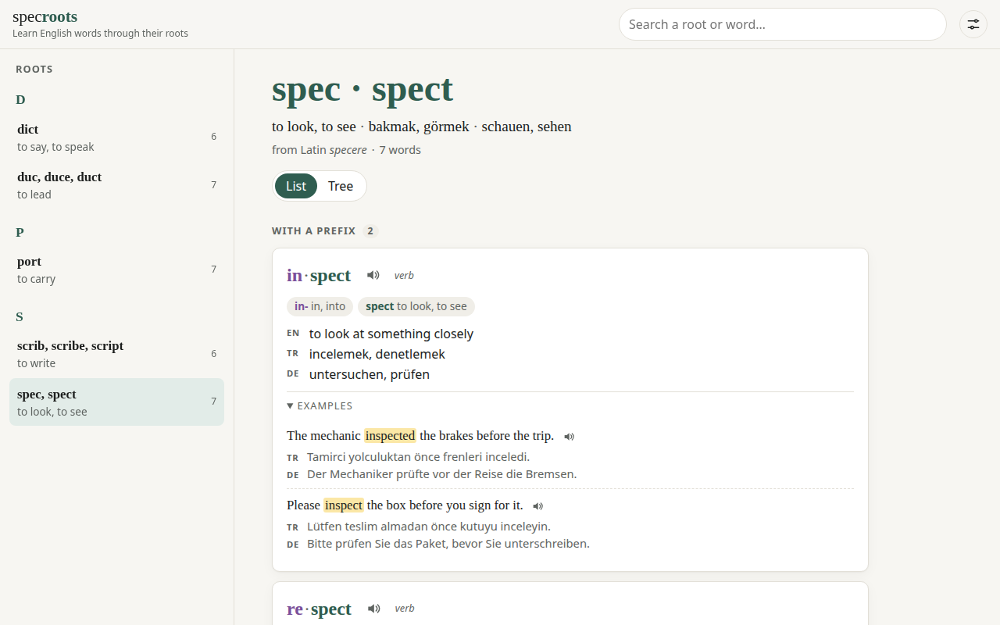

# specroots

[English](README.md) · **Deutsch** · [Türkçe](README.tr.md)

**Englische Wörter über ihre lateinischen und griechischen Wurzeln lernen.** Wähle eine Wurzel und
sieh ihre ganze Wortfamilie: jedes Wort zerlegt in Präfix · Wurzel · Suffix, seine Bedeutung in den
Sprachen deiner Wahl und kurze Beispielsätze zum Anhören. Kostenlos, Open Source, ohne Konto.

**▶ Zur App: https://writerforight.github.io/specroots/**

<a href="https://writerforight.github.io/specroots/#/root/spec"></a>

## Warum Wurzeln?

Wer eine Wurzel kennt, versteht Dutzende Wörter. *spec / spect* heißt „schauen“, also:
*in·spect* (hineinschauen → untersuchen), *re·spect* (zurückschauen → achten), *spect·ator*
(Zuschauer), *per·spect·ive* (hindurchschauen → Sichtweise).

## Funktionen

- **Wortfamilien**: jede lateinische oder griechische Wurzel mit den englischen Wörtern, die auf ihr
  aufbauen, nach Präfix und Suffix gruppiert (Liste) oder als Baum (Wurzel → Grundwörter → Ableitungen)
- **Wortteile**: jedes Präfix, jede Wurzel und jedes Suffix farbig markiert und erklärt
- **Übersetzungen**: Türkisch, Deutsch, Französisch, Italienisch und Spanisch, beim ersten Besuch frei wählbar
- **Beispielsätze**: zwei kurze Sätze pro Wort, das Wort hervorgehoben, mit Übersetzung
- **Nach Präfix oder Suffix stöbern**: *re-* oder *-ion* wählen und alle Wörter damit sehen, nach Wurzeln geordnet
- **Deutsche Wurzeln**: dasselbe für Deutsch. Wähle *steh-* und sieh *verstehen*, *Verstand*,
  *Gegenstand*, in Teile zerlegt, auf Deutsch, Englisch und in deinen Sprachen erklärt
- **Aussprache** über die Stimmen deines Browsers, **Suche** nach Wurzel oder Wort
- **Oberfläche in sechs Sprachen**, helles und dunkles Design, für Handy und Desktop

## Bisherige Wurzeln

97 Wurzeln und 1781 Wörter, jedes mit zwei Beispielsätzen. Dazu **129 Alltagsgegenstände** in Wortlisten (Kreide, Sieb, Nudelholz…) mit Foto und ihrem Namen in allen sechs Sprachen.

- **Lateinisch (82):** `act` · `ann` · `aqu` · `aud` · `cad` · `cap` · `ced` · `cid` · `clud` · `corp` · `cred` · `cur` · `dict` · `duc` · `estim` · `fac` · `fer` · `fin` · `flect` · `form` · `fort` · `grad` · `grat` · `interpret` · `ject` · `jud` · `junct` · `leg` · `loc` · `magn` · `mand` · `manu` · `ment` · `mit` · `mort` · `mov` · `nat` · `nect` · `nomin` · `nov` · `nunci` · `ped` · `pel` · `pend` · `pil` · `plic` · `port` · `pos` · `prehend` · `press` · `pret` · `put` · `rat` · `rupt` · `scend` · `sci` · `scrib` · `sed` · `sent` · `sequ` · `sign` · `sist` · `solv` · `spec` · `sper` · `spir` · `struct` · `sum` · `temp` · `tempt` · `ten` · `tend` · `terr` · `tract` · `trib` · `val` · `ven` · `vert` · `vid` · `vinc` · `viv` · `voc`
- **Griechisch (15):** `bio` · `chron` · `crit` · `graph` · `hydr` · `log` · `lys` · `metr` · `morph` · `path` · `phon` · `photo` · `psych` · `scop` · `therm`

Als Nächstes ([SPEC.md](SPEC.md), auf Türkisch): Offline-Nutzung.

## Mitmachen

specroots wächst durch Menschen, die Wörter hinzufügen; alle erscheinen auf der
[Seite „Mitwirkende“](https://writerforight.github.io/specroots/#/contributors).

- **Wörter hinzufügen:** forken, JSON-Dateien schreiben, Pull Request öffnen. Die Kurzfassung steht
  in [CONTRIBUTING.md](CONTRIBUTING.md) (Englisch). **Mit einem KI-Agenten?** Gib ihm
  [AGENTS.md](AGENTS.md): alle Regeln mit einem Beispiel für jede Art von Inhalt, so geschrieben,
  dass ein Agent die Arbeit ohne Rückfragen erledigt.
- **Vorschlagen oder melden:** [englische Wurzel](https://github.com/writerforight/specroots/issues/new?template=new-root.yml), [deutscher Wortstamm](https://github.com/writerforight/specroots/issues/new?template=de-root.yml),
  [Gegenstandsliste](https://github.com/writerforight/specroots/issues/new?template=list.yml) oder [Fehler](https://github.com/writerforight/specroots/issues/new?template=mistake.yml).

## Lokal starten

```sh
npm install
npm run dev      # http://localhost:5173
npm run check    # Typprüfung + Tests
```

## Lizenz

Code und Wortdaten: [MIT](LICENSE). Später aus Wiktionary (CC BY-SA 4.0) oder Tatoeba (CC BY 2.0 FR)
übernommene Daten behalten deren Lizenz und Namensnennung.

---

Von [Eren Can Almaz](https://writerforight.github.io), Student der Elektrotechnik an der RWTH Aachen.
