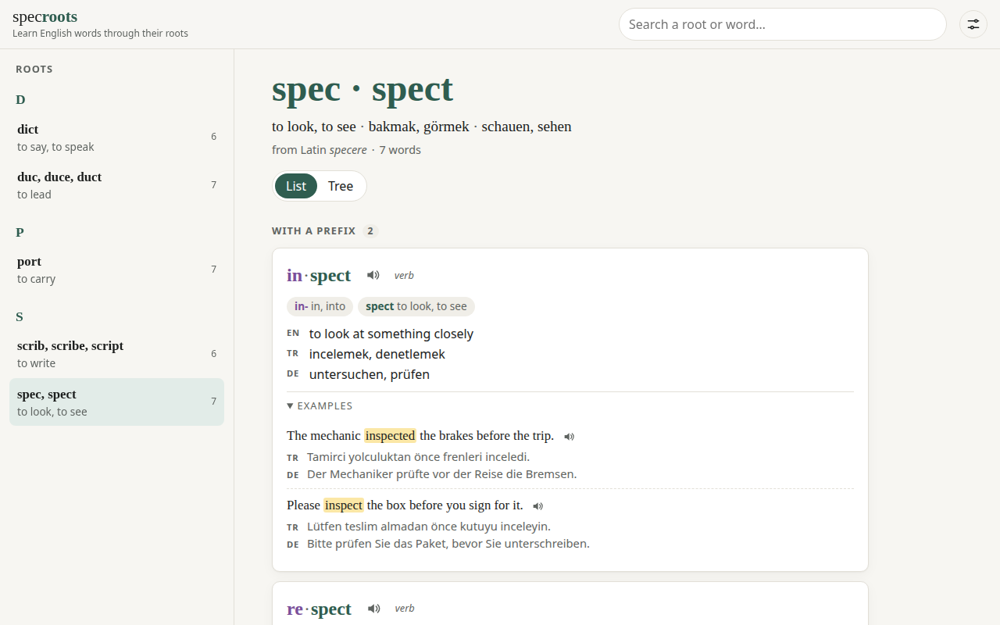
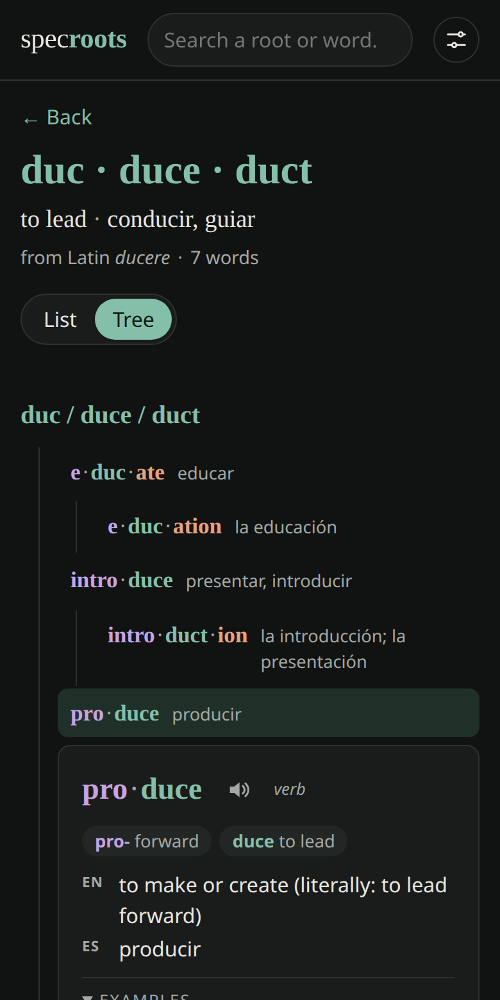

# specroots

**English** · [Deutsch](README.de.md) · [Türkçe](README.tr.md)

**Learn English words through their Latin and Greek roots.** Pick a root and see its whole word family:
every word split into prefix · root · suffix, its meaning in the languages you choose, and short
example sentences you can listen to. Free, open source, no account.

**▶ Open the app: https://writerforight.github.io/specroots/**

<a href="https://writerforight.github.io/specroots/#/root/spec"></a>

## Why roots?

Learn one root and you can read dozens of words. *spec / spect* means "to look", so:

```
spec / spect  "to look"
├── in·spect         to look into → to examine
│   ├── in·spect·ion
│   └── in·spect·or
├── re·spect         to look back at → to look up to
│   └── re·spect·ful
├── spect·ator       one who watches
└── per·spect·ive    looking through → a way of seeing
```

## Features

- **Word families**: each Latin or Greek root with the English words built on it, grouped by prefix
  and suffix (list view) or as a tree from root to base words to derivatives (tree view)
- **Word parts**: every prefix, root and suffix colored and explained (*in-* = into, *-ion* = act of)
- **Translations**: Turkish, German, French, Italian and Spanish; pick any of them on your first visit
- **Example sentences**: two short sentences per word, the word highlighted, with translations
- **Pronunciation**: words and sentences read aloud by your browser's own voices
- **Browse by prefix or suffix**: pick *re-* or *-ion* and see every word built with it, root by root
- **Search**: type a root or a word (`inspection`) and jump straight to it
- **Six interface languages**, light and dark theme, works on phone and desktop



## Roots so far

52 roots and 1161 words, each with two example sentences.

- **Latin (42):** `aud` · `cad` · `cap` · `ced` · `cid` · `clud` · `cred` · `cur` · `dict` · `duc` · `fac` · `fer` · `flect` · `form` · `grad` · `ject` · `junct` · `loc` · `mand` · `mit` · `mov` · `nunci` · `pel` · `pend` · `plic` · `pos` · `port` · `press` · `rupt` · `scrib` · `sent` · `sist` · `spec` · `spir` · `struct` · `ten` · `tend` · `tract` · `ven` · `vert` · `vid` · `voc`
- **Greek (10):** `bio` · `chron` · `graph` · `log` · `metr` · `morph` · `path` · `phon` · `photo` · `scop`

Next on the roadmap ([SPEC.md](SPEC.md)): offline use.

## Contributing

Missing a root, or found a wrong translation? [Suggest a root](https://github.com/writerforight/specroots/issues/new?template=new-root.yml)
or [report a mistake](https://github.com/writerforight/specroots/issues/new?template=mistake.yml). Adding a root yourself is one JSON file;
[CONTRIBUTING.md](CONTRIBUTING.md) explains it step by step, and the tests tell you exactly what is
missing.

## Run locally

```sh
npm install
npm run dev      # http://localhost:5173
npm run check    # type check + tests
npm run build    # rebuilds data/index.json, then the site into dist/
```

The code is TypeScript, object-oriented and layered: `domain` (Root, Word, Morpheme…) → `data`
(repository + validating parser) → `services` (settings, search, speech) → `ui` (one class per view)
→ `app`. All colors and fonts live in `src/styles/tokens.css`.

## License

Code: [MIT](LICENSE). The word data in `public/data` was written for this project and is under the
same license. Data compiled later from Wiktionary (CC BY-SA 4.0) or Tatoeba (CC BY 2.0 FR) will keep
those licenses and their attribution.

---

Made by [Eren Can Almaz](https://writerforight.github.io), an Electrical Engineering (Elektrotechnik)
student at RWTH Aachen University.
