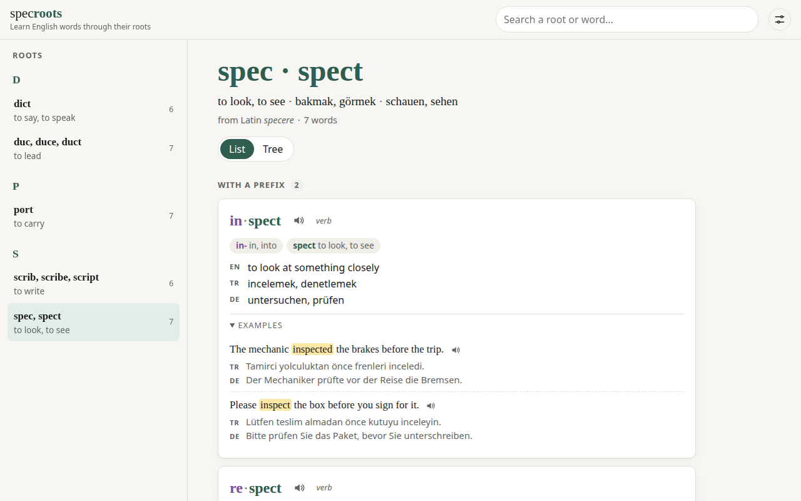
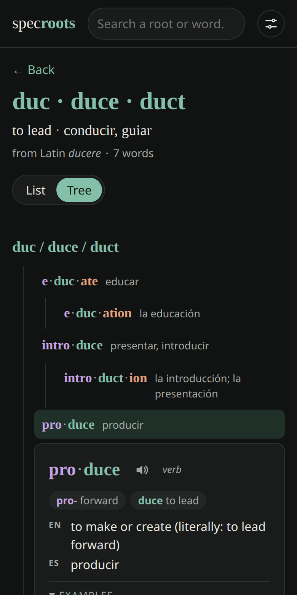

# specroots

**English** · [Deutsch](README.de.md) · [Türkçe](README.tr.md)

**Learn English words through their Latin and Greek roots.** Pick a root and see its whole word family:
every word split into prefix · root · suffix, its meaning in the languages you choose, and short
example sentences you can listen to. Free, open source, no account.

**▶ Open the app: https://writerforight.github.io/specroots/**

<a href="https://writerforight.github.io/specroots/#/root/spec"></a>

## Why roots?

Learn one root and you can read dozens of words. *spec / spect* means "to look", so:

```
spec / spect  "to look"
├── in·spect         to look into → to examine
│   ├── in·spect·ion
│   └── in·spect·or
├── re·spect         to look back at → to look up to
│   └── re·spect·ful
├── spect·ator       one who watches
└── per·spect·ive    looking through → a way of seeing
```

## Features

- **Word families**: each Latin or Greek root with the English words built on it, grouped by prefix
  and suffix (list view) or as a tree from root to base words to derivatives (tree view)
- **Word parts**: every prefix, root and suffix colored and explained (*in-* = into, *-ion* = act of)
- **Translations**: Turkish, German, French, Italian and Spanish; pick any of them on your first visit
- **Example sentences**: two short sentences per word, the word highlighted, with translations
- **Pronunciation**: words and sentences read aloud by your browser's own voices
- **Browse by prefix or suffix**: pick *re-* or *-ion* and see every word built with it, root by root
- **German roots**: the same idea for German. Pick *steh-* (to stand) and see *verstehen*, *Verstand*,
  *Gegenstand*, each split into parts, explained in German, English and your languages
- **Search**: type a root or a word (`inspection`) and jump straight to it
- **Six interface languages**, light and dark theme, works on phone and desktop



## Roots so far

97 roots and 1781 words, each with two example sentences. Plus **129 everyday objects** in word lists (chalk, colander, rolling pin…) with photos and their names in all six languages.

- **Latin (82):** `act` · `ann` · `aqu` · `aud` · `cad` · `cap` · `ced` · `cid` · `clud` · `corp` · `cred` · `cur` · `dict` · `duc` · `estim` · `fac` · `fer` · `fin` · `flect` · `form` · `fort` · `grad` · `grat` · `interpret` · `ject` · `jud` · `junct` · `leg` · `loc` · `magn` · `mand` · `manu` · `ment` · `mit` · `mort` · `mov` · `nat` · `nect` · `nomin` · `nov` · `nunci` · `ped` · `pel` · `pend` · `pil` · `plic` · `port` · `pos` · `prehend` · `press` · `pret` · `put` · `rat` · `rupt` · `scend` · `sci` · `scrib` · `sed` · `sent` · `sequ` · `sign` · `sist` · `solv` · `spec` · `sper` · `spir` · `struct` · `sum` · `temp` · `tempt` · `ten` · `tend` · `terr` · `tract` · `trib` · `val` · `ven` · `vert` · `vid` · `vinc` · `viv` · `voc`
- **Greek (15):** `bio` · `chron` · `crit` · `graph` · `hydr` · `log` · `lys` · `metr` · `morph` · `path` · `phon` · `photo` · `psych` · `scop` · `therm`

Next on the roadmap ([SPEC.md](SPEC.md)): offline use.

## Contributing

specroots grows through people who add words, and everyone who does appears on the
[Contributors page](https://writerforight.github.io/specroots/#/contributors).

- **Add words:** fork, write JSON files, open a pull request. [CONTRIBUTING.md](CONTRIBUTING.md) is the
  short version. **Using an AI agent?** Point it at [AGENTS.md](AGENTS.md): the full rules with an
  example for every kind of content, written so an agent can do the job without asking.
- **Suggest or report:** an [English root](https://github.com/writerforight/specroots/issues/new?template=new-root.yml), a [German root](https://github.com/writerforight/specroots/issues/new?template=de-root.yml),
  an [object list](https://github.com/writerforight/specroots/issues/new?template=list.yml), or [a mistake](https://github.com/writerforight/specroots/issues/new?template=mistake.yml).

## Run locally

```sh
npm install
npm run dev      # http://localhost:5173
npm run check    # type check + tests
npm run build    # rebuilds data/index.json, then the site into dist/
```

The code is TypeScript, object-oriented and layered: `domain` (Root, Word, Morpheme…) → `data`
(repository + validating parser) → `services` (settings, search, speech) → `ui` (one class per view)
→ `app`. All colors and fonts live in `src/styles/tokens.css`.

## License

Code: [MIT](LICENSE). The word data in `public/data` was written for this project and is under the
same license. Data compiled later from Wiktionary (CC BY-SA 4.0) or Tatoeba (CC BY 2.0 FR) will keep
those licenses and their attribution.

---

Made by [Eren Can Almaz](https://writerforight.github.io), an Electrical Engineering (Elektrotechnik)
student at RWTH Aachen University.
