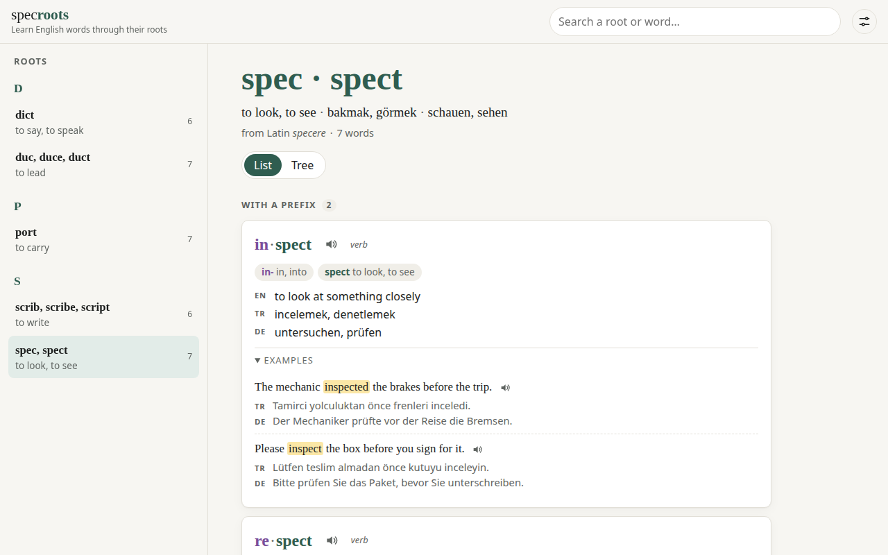

# specroots

[English](README.md) · [Deutsch](README.de.md) · **Türkçe**

**İngilizce kelimeleri Latince ve Yunanca kökleriyle öğren.** Bir kök seç, onunla kurulan bütün
kelime ailesini gör: her kelime ön ek · kök · son ek olarak ayrılmış, seçtiğin dillerde anlamı
yazılı, dinleyebileceğin kısa örnek cümlelerle. Ücretsiz, açık kaynak, hesap gerekmez.

**▶ Uygulamayı aç: https://writerforight.github.io/specroots/**

<a href="https://writerforight.github.io/specroots/#/root/spec"></a>

## Neden kökler?

Bir kökü öğrenen onlarca kelimeyi okuyabilir. *spec / spect* "bakmak" demek, yani:
*in·spect* (içine bakmak → incelemek), *re·spect* (geri bakmak → saygı duymak), *spect·ator*
(seyirci), *per·spect·ive* (içinden bakmak → bakış açısı).

## Özellikler

- **Kelime aileleri**: her Latince ya da Yunanca kök ve ondan türeyen İngilizce kelimeler; ön eke ve
  son eke göre gruplu (liste) ya da kökten temel kelimelere ve türevlere uzanan ağaç olarak
- **Kelime parçaları**: her ön ek, kök ve son ek renkli ve anlamıyla
- **Çeviriler**: Türkçe, Almanca, Fransızca, İtalyanca ve İspanyolca; ilk açılışta istediklerini seç
- **Örnek cümleler**: kelime başına iki kısa cümle, kelime vurgulu, çevirisiyle
- **Ön ek ve son eklerle gezinme**: *re-* ya da *-ion* seç, onunla kurulan bütün kelimeleri kök kök gör
- **Almanca kökler**: aynı fikir Almanca için. *steh-* (durmak) kökünü seç, *verstehen*, *Verstand*,
  *Gegenstand* gibi kelimeleri parçalarına ayrılmış, Almanca, İngilizce ve seçtiğin dillerde açıklamalı gör
- **Telaffuz** tarayıcının kendi sesleriyle, kök ya da kelimeyle **arama**
- **Altı dilde arayüz**, açık ve koyu tema, telefonda ve bilgisayarda çalışır

## Şu ana kadarki kökler

97 kök ve 1781 kelime, her biri iki örnek cümleyle. Ayrıca fotoğraflı ve altı dilde adıyla kelime listelerinde **129 gündelik nesne** (tebeşir, kevgir, oklava…).

- **Latince (82):** `act` · `ann` · `aqu` · `aud` · `cad` · `cap` · `ced` · `cid` · `clud` · `corp` · `cred` · `cur` · `dict` · `duc` · `estim` · `fac` · `fer` · `fin` · `flect` · `form` · `fort` · `grad` · `grat` · `interpret` · `ject` · `jud` · `junct` · `leg` · `loc` · `magn` · `mand` · `manu` · `ment` · `mit` · `mort` · `mov` · `nat` · `nect` · `nomin` · `nov` · `nunci` · `ped` · `pel` · `pend` · `pil` · `plic` · `port` · `pos` · `prehend` · `press` · `pret` · `put` · `rat` · `rupt` · `scend` · `sci` · `scrib` · `sed` · `sent` · `sequ` · `sign` · `sist` · `solv` · `spec` · `sper` · `spir` · `struct` · `sum` · `temp` · `tempt` · `ten` · `tend` · `terr` · `tract` · `trib` · `val` · `ven` · `vert` · `vid` · `vinc` · `viv` · `voc`
- **Yunanca (15):** `bio` · `chron` · `crit` · `graph` · `hydr` · `log` · `lys` · `metr` · `morph` · `path` · `phon` · `photo` · `psych` · `scop` · `therm`

Sıradaki adım ([SPEC.md](SPEC.md)): internetsiz kullanım.

## Katkı

specroots kelime ekleyen insanlarla büyür; ekleyen herkes
[Katkıda bulunanlar sayfasında](https://writerforight.github.io/specroots/#/contributors) görünür.

- **Kelime ekle:** forkla, JSON dosyalarını yaz, pull request aç. Kısa anlatım
  [CONTRIBUTING.tr.md](CONTRIBUTING.tr.md) içinde. **AI ajanı mı kullanıyorsun?** Ona
  [AGENTS.md](AGENTS.md)'yi göster (Türkçesi [AGENTS.tr.md](AGENTS.tr.md)): her içerik türü için
  örnekli kuralların tamamı, ajan işi soru sormadan yapabilsin diye yazıldı.
- **Öner ya da bildir:** [İngilizce kök](https://github.com/writerforight/specroots/issues/new?template=new-root.yml), [Almanca kök](https://github.com/writerforight/specroots/issues/new?template=de-root.yml),
  [nesne listesi](https://github.com/writerforight/specroots/issues/new?template=list.yml) ya da [hata](https://github.com/writerforight/specroots/issues/new?template=mistake.yml).

## Yerelde çalıştırma

```sh
npm install
npm run dev      # http://localhost:5173
npm run check    # tip denetimi + testler
```

## Lisans

Kod ve kelime verisi: [MIT](LICENSE). İleride Wiktionary (CC BY-SA 4.0) ya da Tatoeba'dan
(CC BY 2.0 FR) alınacak veri kendi lisansını ve atfını korur.

---

[Eren Can Almaz](https://writerforight.github.io) tarafından yapıldı; RWTH Aachen Üniversitesi'nde
Elektrik Mühendisliği (Elektrotechnik) öğrencisi.
